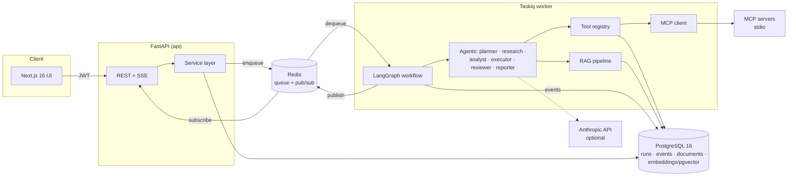

# AgentOS

A production-grade multi-agent AI platform: submit a task, and a coordinated team of
specialized agents plans it, executes real tools, pauses for human approval on
high-impact operations, validates the result, and produces a traceable report —
with persistent state, real-time streaming, multi-tenant isolation, and audit
logging throughout.

**Honesty contract**: nothing in this project fakes progress. Every number in the UI
comes from persisted execution data; token usage is `null` when the provider doesn't
report it; retrieval results say which method produced them; unverified surfaces are
listed in [Limitations](#limitations--unverified-surfaces).

## Architecture



Details: [docs/architecture.md](docs/architecture.md) · security model:
[docs/security.md](docs/security.md) · plan & milestone log:
[docs/implementation-plan.md](docs/implementation-plan.md)

### The agents

| Agent | Responsibility | Tools (server-enforced allowlist) |
|---|---|---|
| Planner | request → validated, dependency-ordered plan with budgets | none |
| Research | knowledge-base search, grounded findings, never invents sources | kb.search, kb.get_document |
| Data Analyst | deterministic CSV metrics — math in code, never in the model | dataset.*, calculator, sql.read_query |
| Executor | business tools (demo CRM); sends require human approval | crm.* |
| Reviewer | schema/evidence/arithmetic checks, bounded revisions | calculator |
| Reporter | final report with evidence appendix, persisted artifact | report.render |

Every agent has a **deterministic implementation** and an optional LLM-augmented mode
(Anthropic). The mode is recorded per run and shown in the UI. The full platform —
planning, tools, approvals, review, reporting — works **without any LLM API key**.

## Quick start (local, no Docker)

Prerequisites: PostgreSQL 16+ and Redis reachable locally, [uv](https://docs.astral.sh/uv/),
Node 22+. Works on Windows and Linux.

```bash
# 1. Configure
cp .env.example .env          # set AGENTOS_SECRET_KEY (any long random string)
                              # and the database/redis URLs if they differ

# 2. Create databases (psql -U postgres):
#    CREATE DATABASE agentos; CREATE DATABASE agentos_test;

# 3. Backend
cd backend
uv sync                       # provisions Python 3.12 + dependencies
uv run alembic upgrade head   # migrations (pgvector is optional — see note below)
uv run python -m scripts.seed # demo org, documents, dataset (synthetic, labeled)

# 4. Run (three terminals)
uv run uvicorn app.main:app --port 8000                      # API
uv run taskiq worker app.worker.broker:broker --workers 1    # worker
cd ../frontend && npm install && npm run dev                 # UI on :3000
```

Open http://localhost:3000 and sign in with `demo@example.com` / `agentos-demo-123`
(or create your own workspace). Then follow [docs/demo.md](docs/demo.md) for the three
scripted scenarios. API docs: http://localhost:8000/api/docs.

> **Windows note**: the stock Windows Redis port (3.0.x) works — the code pins the
> RESP2 protocol. If the frontend runs on a port other than 3000 (e.g. 3000 is taken),
> set `AGENTOS_FRONTEND_ORIGIN` accordingly or API calls will fail CORS.

### Docker Compose

```bash
cp .env.example .env
docker compose up -d postgres redis
docker compose run --rm api alembic upgrade head
docker compose run --rm api python -m scripts.seed
docker compose up -d
```

The Compose stack uses `pgvector/pgvector:pg16`, so semantic search runs through the
pgvector SQL path. **Disclosed**: Compose was authored on a machine without Docker and
is not runtime-verified — see Limitations.

## AI Project Manager (agent harness)

Beyond single runs, AgentOS has a PM control layer (see
[docs/pm-harness.md](docs/pm-harness.md)): create a **project** with a goal and the
PM proposes a versioned, dependency-aware plan that executes only after your
approval. Tasks form a server-validated DAG (cycles rejected, failed dependencies
keep dependents blocked with explicit reasons), are claimed atomically by workers,
run through the existing engine (tools, approval gates, events intact), and pass a
deterministic acceptance review with bounded rework before counting as done.
Explicit agent requests are honored but never bypass prerequisites — asking for the
Reviewer with no deliverables yields an explanation plus a prerequisite plan to
approve, not a fake review. The Projects UI shows the live workflow graph, a task
board, the event timeline, and a PM conversation whose replies report only verified
backend results. Channel adapters (future Telegram bot) are designed in
[docs/telegram-adapter.md](docs/telegram-adapter.md) — same services, no second engine.

## Demo scenarios (reproducible)

Seeded by `scripts.seed`; full walkthrough in [docs/demo.md](docs/demo.md).

1. **Sales intelligence** — "Analyze the last 30 days of sales and identify
   underperforming products". Deterministic dataset tools compute real metrics over
   the seeded CSV; two products are flagged by an explicit share criterion; research
   grounds remediation in the seeded playbook; a downloadable report cites every tool
   call.
2. **Research assistant** — "What does our travel policy say about business class
   flights?" Retrieval over ingested documents, answer grounded in chunk-level
   sources; missing evidence is declared, never papered over.
3. **Business workflow with approval** — "Prepare a customer follow-up for CUST-1001
   and send it". The executor drafts from mock-CRM data, then pauses: the run sits in
   `waiting_approval` until an admin approves in the UI (a server-side state
   transition, audited). Only then does the send execute — into an inspectable outbox
   file, clearly labeled demo.

## Verification status (what was actually run)

On the development machine (Windows 11, local Postgres 16.15 + Redis 3.0, no LLM key):

- `uv run pytest -q` → **62 passed** — unit + integration (auth, tenancy isolation,
  tool registry enforcement, engine retries/timeouts/cancellation, approval gates,
  RAG ingestion/retrieval, MCP stdio discovery and gated execution, SSE replay).
- `uv run ruff check` → clean. `npm run build` + `npm run lint` → clean.
- Live-stack check (real uvicorn + real Taskiq worker over Redis): register → upload →
  ingestion → grounded research run → SSE over HTTP → CRM approval pause → approve →
  resume → outbox delivery. 14/14 checks passed; Scenario A verified with exact
  computed totals.
- `alembic upgrade head` verified from a clean database (the test suite also
  migrates from scratch every session).

## Screenshots

The UI is a premium light SaaS design (app background `#F7F8FA`, white surfaces,
`#635BFF` accent, Geist type): grouped sidebar, breadcrumb top bar, stat tiles,
document-style reports, a light workflow graph with per-status node accents, and a
timestamped execution timeline with expandable event details.

To capture a full authenticated set yourself, run the stack + seed, then:

```bash
cd frontend && node scripts/qa-screenshots.mjs ./shots
```

The script logs in as the demo user, screenshots every page at desktop and mobile
widths (including a waiting-approval run and the report view), and reports browser
console errors. It requires `npx playwright install chromium` once.

## Limitations & unverified surfaces

- **Live LLM calls are unverified**: no Anthropic API key was available during
  development. The provider (SDK 2.0, model `claude-sonnet-5-5`, 60 s timeout)
  and the PM's LLM planning pipeline are fully covered by fake-provider tests,
  including malformed/hostile model output; enable live with
  `AGENTOS_LLM_PROVIDER=anthropic` + `AGENTOS_ANTHROPIC_API_KEY`, then run the
  opt-in live test: `uv run pytest -m live_llm` (it skips with an explicit
  reason when the key is absent). See docs/pm-harness.md §3a.
- **Docker Compose is not runtime-verified** (no Docker on the dev machine). Images
  and commands follow standard patterns; treat the first `docker compose up` as a
  validation step.
- **pgvector SQL path** is implemented + unit-tested, but the dev machine's Windows
  Postgres lacks the extension, so it ran only through the service-layer cosine
  fallback locally. CI/Compose use the pgvector image.
- **Semantic embeddings** require a Voyage/OpenAI key. The default `local-hash`
  provider is deterministic and lexical — labeled as such in the UI; it is not a
  semantic model.
- **PostgreSQL RLS** policies are installed but dormant under the default superuser
  connection (PostgreSQL semantics). Service-layer tenancy scoping is the enforced,
  tested control. See docs/security.md.
- No refresh tokens / MFA / SSO; single-org UX (multi-org memberships work at the API
  level via `X-Organization-Id`). Production hardening list in docs/security.md.

## Repository map

```
backend/app/     engine/ (LangGraph graph+runner) · agents/ · tools/ (registry+builtin)
                 llm/ · rag/ · mcp_client/ · api/v1/ · services/ · models/ · events/ · worker/
backend/tests/   62 tests: unit, integration, live-ish e2e via inline broker
backend/alembic/ migrations incl. conditional pgvector + RLS
frontend/src/    Next.js app: 8 pages, SSE hook, workflow graph, run view
scripts/         demo MCP server · demo data (synthetic) · RLS role provisioning
docs/            architecture · security · tooling (tools/permissions/artifacts guide) ·
                 implementation plan (milestone log) · pm-harness · demo · troubleshooting
```

Developer commands: see `Makefile` (or run the underlying commands directly on
Windows). Troubleshooting: [docs/troubleshooting.md](docs/troubleshooting.md).
