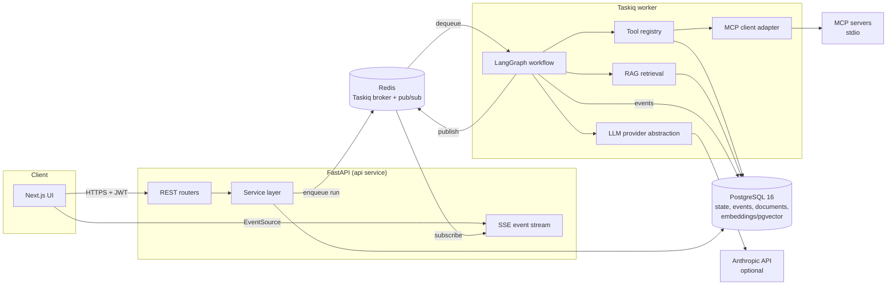

# AgentOS — Architecture

## 1. System overview

AgentOS is a modular monolith: one FastAPI application (HTTP API + SSE), one Taskiq worker process (agent workflow execution), PostgreSQL (state, events, vectors), and Redis (task queue + event pub/sub). The frontend is a separate Next.js application consuming the API.



## 2. Repository layout

```
backend/
  app/
    api/            # routers only — no business logic
    core/           # settings, logging, security (JWT/passwords), dependencies
    db/             # engine/session, base, capability detection
    models/         # SQLAlchemy 2.x declarative models
    schemas/        # Pydantic v2 request/response + agent I/O contracts
    services/       # business logic (runs, approvals, documents, audit, ...)
    engine/         # LangGraph graph, nodes, state schema, budgets, errors
    agents/         # per-agent node implementations (planner, research, ...)
    tools/          # registry + built-in tool implementations
    llm/            # provider abstraction: anthropic / fake / none
    rag/            # extraction, chunking, embeddings, retrieval
    mcp_client/     # MCP adapter (stdio), discovery, namespacing
    events/         # event recording + Redis pub/sub + SSE formatting
    worker/         # taskiq broker + task definitions
  alembic/          # migrations
  tests/            # unit / integration / e2e
frontend/           # Next.js app
scripts/            # seed, demo MCP server, demo data
docs/               # this file, implementation-plan.md, security.md, troubleshooting.md
docker-compose.yml, Makefile, .env.example, .github/workflows/ci.yml
```

## 3. Data model (principal tables)

All tenant-owned rows carry `organization_id` (FK, indexed). UUID PKs, UTC `timestamptz` timestamps, `created_at/updated_at` via server defaults.

- `users` — email (citext-unique per deployment), password_hash (bcrypt), is_active
- `organizations`, `organization_members` — role: `owner | admin | member | viewer`
- `projects` — workspace grouping for runs and documents
- `agent_definitions` — seeded registry: key, name, description, model config, allowed tool names, limits (max_iterations, timeout_s)
- `agent_runs` — status state machine: `queued → planning → running → waiting_approval → reviewing → reporting → completed | failed | cancelled`; budgets; token/cost fields **nullable** (null = provider did not report); requested_by; correlation id
- `run_tasks` — planner-produced plan nodes: agent key, objective, depends_on (UUID[]), status, attempt count, structured output (JSONB)
- `execution_events` — append-only run timeline: seq (per-run monotonic), type, payload JSONB, created_at. Source of truth for the UI.
- `tool_calls` — tool name, arguments (redacted per tool policy), result summary, status, duration_ms, error, approval_request_id FK
- `approval_requests` — status `pending → approved | rejected | expired`, operation summary, payload, requested_by (agent), decided_by (user FK), decided_at. **Server-side gate — see security.md.**
- `conversations`, `conversation_messages` — user↔run message history
- `documents` — filename, mime, sha256 (dedup per org), status `pending → processing → ready | failed`, error, size, uploaded_by
- `document_chunks` — ordinal, text, metadata JSONB, embedding (pgvector `vector` column when available; always mirrored in `embedding_json` JSONB for the fallback path)
- `reports` — run FK, markdown body, format, artifacts
- `audit_log` — actor (user/agent/system), action, entity ref, org, ip, metadata

## 4. Agent engine

### State & contracts
`EngineState` (TypedDict for LangGraph) carries: run id, org id, plan (list of task specs), per-task outputs, review verdicts, budget counters, failure info. Agent inputs/outputs are Pydantic models (`PlannerOutput`, `ResearchFindings`, `AnalysisResult`, `ExecutorResult`, `ReviewVerdict`, `FinalReport`) — validated at every node boundary; validation failure = node failure, retried up to the bound, then run fails with a recorded error.

### Graph
```
plan → (validate plan) → task loop:
   select next ready task (deps satisfied) → route to agent node
   research | analyze | execute(approval interrupt) ─┐
   ← bounded retry on transient failure              │
review (≤ max_review_iterations, may send one bounded revision) ←┘
report → finalize
```
- **Checkpointing**: LangGraph Postgres checkpointer; approval interrupts persist graph state so the worker can resume after a decision — even after process restart.
- **Budgets**: max tasks per plan, max tool calls per task, max LLM calls per run, wall-clock timeout per task and per run. Enforced in code, not by prompt.
- **Cancellation**: cooperative — run status flipped to `cancelling` in DB; nodes check between steps; tool executor also enforces per-call timeouts.
- **Retries**: only errors classified transient (timeouts, 5xx, rate limits) retry, with exponential backoff and attempt cap; tool calls flagged non-idempotent never auto-retry.

### Deterministic vs LLM mode (ADR-004)
Each cognitive step has two implementations behind one interface:
- `llm` mode (provider configured): structured-output prompting, schema-validated.
- `deterministic` mode: rule-based planner templates for recognized task types (sales CSV analysis, KB question, CRM follow-up), keyword retrieval ranking, checklist-based review (arithmetic re-verified in code either way).
Which mode ran is recorded on every task output and shown in the UI. Numeric work is **always** computed by tools, never by the LLM.

## 5. Tool system

`ToolSpec`: name, description, Pydantic input/output models, `required_permission`, `requires_approval`, `timeout_s`, `idempotent`, `redact_fields`. The registry is the only execution path: it validates args against the schema, checks the calling agent's allowlist and the run's org permissions, creates the `tool_calls` row, enforces timeout, redacts configured fields from logs/events, and records the audit entry.

Built-ins: `dataset.inspect`, `dataset.stats`, `dataset.aggregate`, `calculator.evaluate` (AST-whitelisted, no eval), `sql.read_query` (SELECT-only, table/column allowlist, parameterized, statement_timeout, row cap), `kb.search`, `kb.get_document`, `report.render`, `crm.get_customer` / `crm.draft_followup` / `crm.send_followup` (mock CRM; `send` requires approval).

MCP tools are discovered per configured server, namespaced `mcp:<server>:<tool>`, treated as untrusted (descriptions sanitized before entering prompts, results wrapped as data), and `requires_approval=True` by default.

## 6. RAG pipeline

upload → sha256 dedup check → store file → enqueue ingestion → extract (txt/md/csv native, pdf via pypdf) → normalize → chunk (char-window with overlap, paragraph-aware) → embed (configured provider) → persist chunks + vectors → status `ready`. Any step failure → status `failed` + error message persisted; no partial "ready" states.

Embedding providers (explicit `EMBEDDINGS_PROVIDER` setting, no silent fallback): `voyage`, `openai`, `local-hash` (deterministic feature-hash TF vectors — honest about being lexical, suitable for offline demo/tests; labeled in UI). Query-time: same provider embeds the query; search runs via pgvector cosine SQL when the extension is active, otherwise service-layer cosine over the org's chunks. Every retrieval result carries document id, filename, chunk ordinal, and score. Access check: retrieval queries are always org-scoped and verified against the caller's membership **before** touching chunk data.

## 7. Real-time events

Writer path: `EventRecorder.record(run_id, type, payload)` → INSERT `execution_events` (per-run seq) → `PUBLISH agentos:events:<run_id>`. Reader path: `GET /api/v1/runs/{id}/events/stream` (SSE) authenticates, authorizes org access, replays rows after `Last-Event-ID`, then relays pub/sub messages; 15s heartbeat comments. Event ids are `seq` values so reconnection is lossless. The UI derives *all* progress display from these events.

## 8. Configuration

Pydantic Settings, env-prefixed (`AGENTOS_`), `.env` for dev. Secrets only via environment. Capability flags (pgvector present, LLM configured, embeddings provider) are detected/derived at startup and exposed read-only at `/api/v1/meta/capabilities` for the Settings page — no secret values ever returned.

## 9. Known deviations & unverified surfaces

- Docker Compose is provided but **not runtime-verified** (no Docker on the dev machine).
- Anthropic live calls **unverified** (no key). Fake provider covers the contract in tests; opt-in marker `live_llm` for real-API tests.
- pgvector path exercised only when the extension exists; CI uses the pgvector image, local Windows uses the fallback. Both paths unit-tested; the SQL path is integration-tested only where the extension is available.
- PostgreSQL RLS policies ship in a migration but are enforced only when the app connects as the non-superuser `agentos_app` role (Compose does this; local dev with `postgres` superuser bypasses RLS — service-layer scoping still applies). See security.md.
